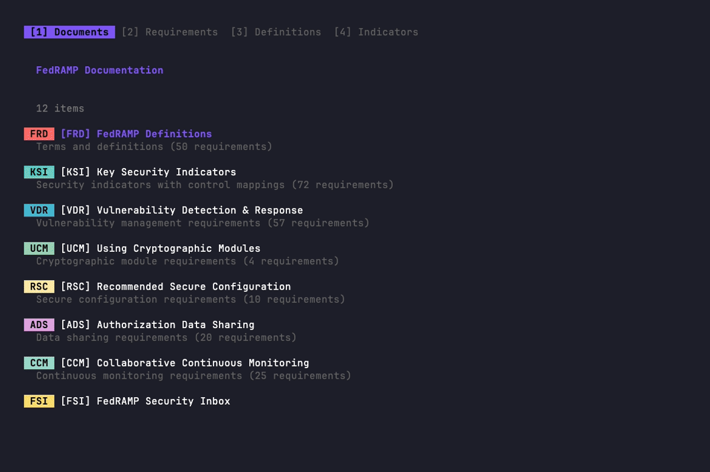

# FedRAMP Browser

[](https://goreportcard.com/report/github.com/hackIDLE/fedramp-browser)
[](https://github.com/hackIDLE/fedramp-browser/releases)
[](https://opensource.org/licenses/MIT)

A terminal user interface for browsing FedRAMP documentation.

## Demo



## Features

- Browse all 12 FedRAMP document categories
- Filter and search requirements across documents (`MUST`, `SHOULD`, provider/agency/assessor scope)
- Look up FedRAMP definitions and Key Security Indicators (KSIs) with NIST SP 800-53 mappings

## Installation

### Homebrew (macOS/Linux)

```bash
brew install hackIDLE/tap/fedramp-browser
```

### Scoop (Windows)

```powershell
scoop bucket add hackidle https://github.com/hackIDLE/scoop-bucket
scoop install fedramp-browser
```

### Download Binary

Download from [Releases](https://github.com/hackIDLE/fedramp-browser/releases):

| Platform | Binary |
|----------|--------|
| macOS (Apple Silicon) | `fedramp-browser-darwin-arm64` |
| macOS (Intel) | `fedramp-browser-darwin-amd64` |
| Linux (x64) | `fedramp-browser-linux-amd64` |
| Linux (ARM64) | `fedramp-browser-linux-arm64` |
| Windows (x64) | `fedramp-browser-windows-amd64.exe` |

### Go Install

```bash
go install github.com/hackIDLE/fedramp-browser@latest
```

### Build from Source

```bash
git clone https://github.com/ethanolivertroy/open-ctrl-tools.git
cd open-ctrl-tools/tools/fedramp-browser
go build -o fedramp-browser .
```

## Usage

```bash
fedramp-browser
```

### Command Line Options

| Flag | Description |
|------|-------------|
| `--refresh` | Force fresh fetch from GitHub, ignoring cache |

### Caching

Data is cached locally at `~/.cache/fedramp-browser/` with a 24-hour TTL. On subsequent runs, the TUI loads instantly from cache. Use `--refresh` to force a fresh fetch.

### Key Bindings

| Key | Action |
|-----|--------|
| `1` | View Documents |
| `2` | View Requirements |
| `3` | View Definitions |
| `4` | View Key Security Indicators |
| `j/k` or `↑/↓` | Navigate list |
| `Enter` | View details |
| `Esc` or `Backspace` | Go back |
| `/` | Filter/search |
| `m` | Filter MUST requirements (Requirements view) |
| `s` | Filter SHOULD requirements (Requirements view) |
| `x` | Cycle affects filter: All → Providers → Agencies → Assessors → FedRAMP (Requirements view) |
| `f` | Clear filters (Requirements view) |
| `q` | Quit |

## Data Sources

Data is fetched from the [FedRAMP/rules](https://github.com/FedRAMP/rules) GitHub repository (`fedramp-consolidated-rules.json`).

### Documents (Consolidated Rules for 2026)

| Code | Name |
|---|---|
| FRD | FedRAMP Definitions |
| KSI | Key Security Indicators |
| AFC | Addressing FedRAMP Communication |
| AGU | Agency Use of FedRAMP Certified Cloud Services |
| CCM | Collaborative Continuous Monitoring |
| CDS | Certification Data Sharing |
| CMU | Cryptographic Module Use |
| CPO | Certification Package Overview |
| FRC | FedRAMP Certification |
| IEC | Incident Evaluation and Communication |
| IVV | Independent Verification and Validation |
| MAS | Minimum Assessment Scope |
| MKT | Marketplace Listing |
| REC | FedRAMP Recognition of Independent Assessment Services |
| SCG | Secure Configuration Guide |
| SCN | Significant Change Notification |
| SDR | Security Decision Record |
| VDR | Vulnerability Detection and Response |
| VER | Vulnerability Evaluation and Reporting |

## Acknowledgments

- [Charm](https://charm.sh/) for the TUI libraries: [Bubble Tea](https://github.com/charmbracelet/bubbletea), [Lip Gloss](https://github.com/charmbracelet/lipgloss), [Bubbles](https://github.com/charmbracelet/bubbles)
- [GoReleaser](https://goreleaser.com/) for release automation
- [FedRAMP](https://github.com/FedRAMP/rules) for the consolidated machine-readable rules

## Disclaimer

Unofficial project, not affiliated with or endorsed by GSA or the FedRAMP PMO.

## License

This project is licensed under the MIT License - see the [LICENSE](LICENSE) file for details.
